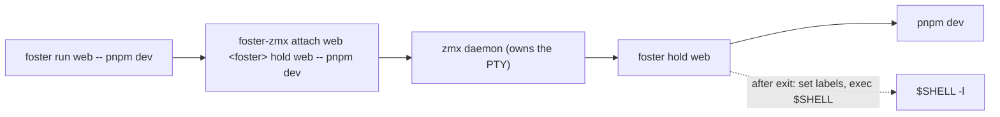

# foster v1: a process registry with PTY attach for one machine

## Overview

Long-running processes on a Mac start from many places: a Zed task, a terminal tab, an agent's Bash tool, `ssh mac cmd` from another laptop. Nothing records what runs, where it was started or how to reach it. A process started from an ssh session either dies with SIGHUP when the link drops or lives on as an orphan nobody can see or reattach to.

foster is one entry point for such processes on one machine. `foster run <name> -- cmd` starts the command inside a persistent PTY session and attaches the caller. The process keeps running after the caller detaches or disconnects. `foster ls` lists every process started this way, running or finished. `foster attach <name>` reconnects from any terminal. `foster rm <name>` stops it and removes the record. A process that exits stays listed as `exited <code>` with its last screen, until `rm` or a new `run` under the same name.

foster does not own PTYs itself. It drives `foster-zmx`: the zmx session daemon (https://github.com/neurosnap/zmx, MIT) built from a pinned revision with agterm's explicit-leadership patches, so the client that attaches takes the PTY size at once instead of after its first keystroke.

Acceptance scenario (the one real workflow): a user starts a dev server with `foster run web -- pnpm dev` from an ssh session on the Mac, the ssh link drops, and later from another terminal `foster ls` shows `web` running and `foster attach web` shows its live output. When the dev server crashes, `foster ls` shows `exited <code>` and `foster attach web` shows the error on screen. `foster rm web` leaves no process of it behind.

### Execution environment

This plan runs only on an Apple Silicon Mac: the ralphex-farm native runner (`runtime: native`), in the repo checkout on the Mac. It is not for the Linux container runner. `foster-zmx` is built for the host and executed by the tests, so a Linux container cannot verify Tasks 1 and 8. The Mac has `git`, `ps`, `shasum`, network access, and every tool the repo's `mise.toml` declares.

### Non-goals (v1)

- One machine only. No listing or attaching across machines.
- No restarts, no supervision, no log files, no rename.
- No auto-detection of the launch source (ssh, Zed, agent). Environment markers stack and are inherited, so any guess is unreliable.
- No processes that foster did not start. Only an explicit `foster run` creates a record.
- No Linux build, no CI workflow, no release artefacts, no Homebrew formula.
- No hiding of the `zmx-role;...` title the patched client reports. In a plain terminal it shows in the tab title; that is accepted.
- Ctrl+Z (job control) inside a foster session is not handled specially.

### Rejected alternatives (fixed decisions, not open for review)

- Own PTY daemon in Rust instead of zmx: an order of magnitude more work (PTY, screen state, multi-client attach, leadership) for no user-visible gain in v1.
- Stock zmx without patches: v1 requires that a fresh attach takes the attaching terminal's PTY size immediately. Stock zmx gives the size to the client that typed last. A later Linux build also needs the patched zmx.
- The zmx binary inside the agterm app bundle: it couples foster to another app's release cadence and exists only on macOS.
- `zmx run` (task mode) for starting commands: it types the command into the login shell followed by `; echo ZMX_TASK_COMPLETED:<id>:$?`. fish rejects `$?` as a parse error and then does not run the command at all. foster must work with any login shell, so it records the exit code itself (see `foster hold`).
- Putting cwd and command into zmx labels: label values allow only `[a-zA-Z0-9-_.]`, and `cwd`, `cmd`, `created`, `pid` are read-only built-in fields that `zmx ls` already prints.
- A separate repository for the patched zmx: no second consumer yet. It lives in this repo under `zmx/`.

## Skills to invoke

If the skills below are available, load each with the Skill tool before implementing a task. The Code-Quality Rules section of this plan is authoritative either way.

- `rust-style` - all code under `src/` and `tests/` must follow it.

## Context (from discovery)

- `Cargo.toml`: package `foster` 0.1.0, `edition = "2024"`, no dependencies yet.
- `mise.toml`: `rust = { version = "1.99.1", components = "clippy,rustfmt" }`. All cargo commands run as `mise exec -- cargo ...`.
- `src/main.rs`: the `cargo init` hello world, replaced in Task 2.
- `.gitignore`: `/target`.
- House conventions (authoritative as written here): errors are `Result<_, String>` printed as `foster: <msg>` to stderr with exit 1; argv parsed by hand with slice patterns, no clap; tests use fake binaries on PATH plus one suite against the real binary.

## Development Approach

- **testing approach**: Regular (code first, then tests in the same task).
- complete each task fully before moving to the next; every task ends with its tests green.
- every new item gets a non-test caller in the same task: under `-D warnings` an unused function, method or struct field fails clippy (`dead_code`), and use only from `#[cfg(test)]` code does not count. Never add `#[allow]` or `#[cfg(test)]` to dodge it. The task list below already orders fields and functions so each lands with its first reader; keep it that way.
- integration test files do not share a module, and each defines only the helpers it calls (an unused helper fails `dead_code`): `tests/cli.rs` has `poll_until`, `process_gone` and its command builders; `tests/real_zmx.rs` has `poll_until`, `processes_with` and its command builders. There is no `tests/common` module.
- every command builder in both test files sets `.stdin(Stdio::null())` unless a test sets stdin explicitly: a spawned child otherwise inherits the test runner's stdin, which can be a terminal, and `run`/`attach` would then take the terminal path.
- **CRITICAL: every task MUST include new/updated tests** for its code changes, success and error cases.
- **CRITICAL: all tests must pass before starting the next task.**
- **CRITICAL: update this plan file when scope changes during implementation.**
- Behaviour marked "observed during planning" below was seen on zmx 0.8.1 before this plan was written. If a test contradicts it, fix the implementation to match the stated behaviour where possible; otherwise update this plan with the observed behaviour and note it in the progress log.

## Code-Quality Rules (verify before marking each task complete)

The `rust-style` skill has no `## Hard rules` block; these are its rules, materialised so every task session enforces them.

**Rust (from `rust-style`):**

- Control flow: `for` loops with mutable accumulators, not iterator chains (`map`/`filter`/`collect`/`find`/`sum`).
- Early returns with `let ... else`. `if let` only for a short branch with no `else`; otherwise `match`.
- Shadow variables through transformations; no `raw_`, `parsed_`, `trimmed_`, `lowercase_` prefixes.
- Newtypes: `SessionName` and `Nonce`. No others are required.
- Enums with named variants instead of `bool` parameters.
- No wildcard `_` arms when matching on this crate's own enums; no `matches!`.
- When a struct or tuple is destructured, list every field (no `..`). Plain `.field` access is allowed.
- No comments of any kind and no doc comments in this binary crate: no inline notes, no section dividers, no TODOs, no commented-out code.

**Per-task gate (all must pass before a checkbox is marked `[x]`):**

1. `mise exec -- cargo fmt --check`
2. `mise exec -- cargo clippy --all-targets -- -D warnings`
3. `mise exec -- cargo test` (from Task 8 on, run `mise exec -- zmx/build.sh` first: `zmx/out` is gitignored and may be absent; the script is a no-op when up to date)
4. `! grep -rnE '^\s*//|\s//\s' src/ tests/` (no comments)
5. `! grep -rn '#\[allow' src/ tests/` (lint findings are fixed, never silenced)
6. `! grep -rnE '\b(raw|parsed|trimmed|lowercase)_[a-z]' src/ tests/` (shadow instead of prefixes)
7. `! grep -rn 'matches!' src/ tests/`

## Testing Strategy

- **unit tests**: in each module (`#[cfg(test)] mod tests`), for parsing, validation, rendering and formatting.
- **CLI tests** (`tests/cli.rs`): run the built `foster` binary (`env!("CARGO_BIN_EXE_foster")`) with `env_clear()`, a temp `HOME`, and `PATH` = a temp `fake-bin` directory followed by `/usr/bin:/bin`. The fakes are shell scripts named `foster-zmx` (and a fake shell where needed) that append every call (argv and the env vars under test) to a log file and print canned output. Tests assert the exact calls and the exact stdout/stderr.
- **real suite** (`tests/real_zmx.rs`): runs the acceptance flows against the real `zmx/out/foster-zmx` built by `zmx/build.sh`. It panics with `run zmx/build.sh first` when that binary is missing. It is never skipped, ignored or pointed at any other zmx (no downloaded or stock zmx). Session names in it stay at most 10 characters, and its `HOME` is created with `tempfile::Builder::new().prefix("f").tempdir_in("/tmp")`: the socket path `$HOME/.local/state/foster/zmx/<name>` must fit in 103 bytes, and `TMPDIR` can be long. The harness asserts that bound at start.
- Timeouts are parameters: `poll_until(timeout, interval, check)` returns as soon as `check` passes and fails the test with a message when `timeout` elapses.
- `process_gone(pid)`: true when `kill(pid, 0)` fails with ESRCH, or when `ps -o stat= -p <pid>` prints an empty string or a state starting with `Z`. A zombie counts as gone. Use it for every "process is gone" assertion.
- `processes_with(marker)`: the lines of `ps -axo command=` that contain `marker`, excluding the `ps` process itself. Used for no-leftover checks; the marker is a per-run unique string (for example `fstr<16 random hex>`), never a generic word such as `foster hold`.

## Solution Overview



- `foster run` creates a zmx session whose PTY process is `foster hold`, not the user command. `hold` runs the command as its child, waits, records `exit_code` and `ended` as zmx labels, prints one status line and replaces itself with the login shell. The session therefore outlives the command, and the last screen stays visible.
- All foster sessions live in their own socket directory, so plain `zmx ls` and agterm never see them and foster never sees theirs.
- `foster ls` is a view over one `foster-zmx ls` call: name, clients, created, cwd and cmd are zmx built-ins; `exit_code` and `ended` are the labels `hold` set.
- Attaching sets `ZMX_MANAGED=<nonce>` and `ZMX_MANAGED_CLAIM=1`, which the patched client reads to claim leadership at attach.

## Technical Details

### foster-zmx build

- Source: `https://github.com/neurosnap/zmx` at `8bab1f0173b07e79835ea372d749af3dbf0d0842` (v0.8.1). Its `build.zig.zon` pins ghostty at `8af6897c0afc63037a8a3efee4162a380e3a4572` from `https://github.com/ghostty-org/ghostty` and declares `minimum_zig_version = "0.16.0"`.
- Compiler: `zig = "0.16.0"` pinned in `mise.toml`. Do not use 0.17: the pinned ghostty revision targets 0.16.
- Patches are vendored from agterm (`https://github.com/umputun/agterm`, MIT) at commit `3b4af3500d174f7857cb882f06e1ef4845d05655`, directory `scripts/zmx-patches/`, byte for byte. Expected sha256:

  | File in this repo | sha256 |
  |---|---|
  | `zmx/patches/0001-explicit-leadership.patch` | `66959e4eb527507f3126e3133b86d8c28b211bf64584bbe0bcaab7de92c138e3` |
  | `zmx/patches/0002-private-ghostty-dependency.patch` | `b24e8a1321dd82dcee375197dee7cb5b538b304f5d765127f4be4c7f628d5cd1` |
  | `zmx/patches/0003-atomic-socket-publish.patch` | `a7fde8ba2678a3737cead340f1cd2a070a63847f781acf9c58950c063c20a8fc` |
  | `zmx/patches/ghostty/0001-formatter-unstyled-blanks.patch` | `b1243789c791d3d4d2720f5fe6f81a959023c651be8e43175c0248d63bd20e5e` |

- What they do: 0001 adds explicit leadership (below); 0002 repoints zmx's ghostty dependency from the zig package cache to the sibling directory `../zmx-ghostty`; 0003 binds a new session socket in `.s/<pid>` and hard-links it to the session name only after `listen`, so a concurrent `ls`/attach cannot delete it as stale; the ghostty patch fixes styled blanks in the screen snapshot replayed on re-attach.
- Each patch is a `diff -ruN` against a pristine tree and applies with `git apply --whitespace=nowarn` (`-p1`). Order: the ghostty patch on the ghostty checkout, then the zmx patches on the zmx checkout in name order.
- Build tree (gitignored): `zmx/.build/zmx` and `zmx/.build/zmx-ghostty` side by side, because patch 0002 expects `../zmx-ghostty` relative to the zmx checkout. Fetch each revision with `git init` + `git remote add origin <url>` + `git fetch --depth 1 origin <rev>` + `git checkout FETCH_HEAD`.
- Stamp: `zmx/out/.stamp` holds one line `<zmx rev> <sha256 of the concatenation of the four patch files in the order listed above>`, computed with `shasum -a 256`. When `zmx/out/foster-zmx` exists and the stamp matches, the script prints exactly `foster-zmx is up to date` and exits 0. Otherwise it deletes `zmx/.build` and `zmx/out`, recreates both checkouts from scratch, applies the patches, builds, installs, and writes the stamp last, so a failed build never leaves a matching stamp.
- Build command, run in `zmx/.build/zmx`: `zig build -Doptimize=ReleaseSafe` (no `-Dtarget`: the build targets the host). Output `zig-out/bin/zmx` is installed as `zmx/out/foster-zmx` (mode 0755), with zmx's `LICENSE` copied to `zmx/out/LICENSE`. The script prints `built zmx/out/foster-zmx` on success.
- A patch that fails to apply makes the script exit 1 with `failed to apply <patch file>` on stderr.
- macOS 27 SDK workaround (only when `uname -s` is `Darwin`): the SDK's `math.h` asks the compiler's `float.h` for `INFINITY`/`NAN` through clang's `__need_infinity_nan` protocol (LLVM PR #164348), which zig 0.16's bundled `float.h` does not implement, so the libc++ build fails with `undeclared identifier 'INFINITY'`. Find `<lib_dir>/include/float.h`, with `lib_dir` from `zig env`. If `grep -q __need_infinity_nan` on that file succeeds, do nothing. Otherwise copy it to `float.h.orig`, then write a new `float.h`: the marker line `/* foster: need_infinity_nan guard */`, then the block below, then the original content, then `#endif /* __need_infinity_nan */` on the last line. A second run sees `__need_infinity_nan` and skips.

  ```c
  #if defined(__need_infinity_nan)
  #  undef INFINITY
  #  undef NAN
  #  define INFINITY (__builtin_inff())
  #  define NAN (__builtin_nanf(""))
  #  undef __need_infinity_nan
  #else
  ```

### Explicit leadership (what patch 0001 does, as foster relies on it)

- A zmx session has one PTY and one size. The "leader" client's window size is applied; other clients draw output laid out for the leader's grid. Stock zmx gives the lead to whichever client last sent bytes it classifies as typing.
- With the patch, a client started with `ZMX_MANAGED=<nonce>` (1 to 64 characters, ASCII letters, digits or `-`) opts into explicit leadership. It leads only if it claims at attach (`ZMX_MANAGED_CLAIM` set to any value) or if it attaches to a session nobody leads. While it follows, the daemon drops its input and its resizes do not claim the lead.
- The daemon reports each role change to the client as a terminal title `OSC 2;zmx-role;<nonce>:<unowned|leader|follower>:<generation>`. foster does not parse it.
- A client without `ZMX_MANAGED` behaves as stock zmx.
- The patch also adds `zmx screen` and `zmx type` (listed by `zmx help`), unused by foster v1 and used only to prove the patch applied.

### zmx commands foster uses

All are called on `foster-zmx` with the environment from "Paths and environment". Every call except the `exec`'d attaches runs with `Command::output()` (stdin null, stdout and stderr captured). Captured stdout is used only where stated below and is never echoed; an error message carries the stderr with trailing whitespace trimmed. Fakes in `tests/cli.rs` print what the real binary prints, on the same stream.

- `foster-zmx attach <name> <command...>`: creates the session if absent with `<command...>` as the PTY process (argv, no shell), then attaches the caller's terminal. Without a terminal on stdin and with stdin at EOF, the client detaches at once and the session keeps running with `clients=0` (observed during planning).
- `foster-zmx attach <name>`: attaches to an existing session. Detach key: Ctrl+\.
- `foster-zmx ls`: the list described below.
- `foster-zmx kill <name>`: the daemon sends SIGHUP to the PTY process group (`kill(-pid, SIGHUP)`), waits 500 ms, sends SIGKILL to the group, disconnects every client and removes the session. The command prints `killed session <name>` on stdout and returns after the socket is gone.
- `foster-zmx set <name> <key>=<value>...`: sets labels on a live session. Values may contain only `[a-zA-Z0-9-_.]`.
- `foster-zmx history <name>`: prints the session scrollback as plain text on stdout, exit 0.

### Paths and environment

- `foster-zmx` lookup: the file `foster-zmx` in the directory of `std::env::current_exe()`, else the first executable `foster-zmx` on `PATH`, else the error `foster-zmx not found next to foster or on PATH; build it with zmx/build.sh`.
- Socket directory: `$HOME/.local/state/foster/zmx`, created with `create_dir_all` before any zmx call. Every zmx call gets `ZMX_DIR` set to it.
- Every zmx call removes these from the child environment: `ZMX_SESSION`, `ZMX_SESSION_PREFIX` (inherited, they make zmx switch the caller's terminal to another session instead of creating one, and mark one `ls` line as current), `ZMX_MANAGED`, `ZMX_MANAGED_CLAIM` (a stale nonce from an outer session), and the ten Claude Code markers `CLAUDECODE`, `CLAUDE_PID`, `AI_AGENT`, `CLAUDE_CODE_CHILD_SESSION`, `CLAUDE_CODE_ENTRYPOINT`, `CLAUDE_CODE_EXECPATH`, `CLAUDE_CODE_MESSAGING_SOCKET`, `CLAUDE_CODE_MESSAGING_TOKEN`, `CLAUDE_CODE_SESSION_ATTENDED`, `CLAUDE_CODE_SESSION_ID` (inherited, they make a Claude started inside the session behave as a child session and stop saving its transcript).
- `Zmx::attach_command(&self, name: &SessionName) -> Command` in `src/zmx.rs` builds `foster-zmx attach <name>` with that environment plus `ZMX_MANAGED=<nonce>` and `ZMX_MANAGED_CLAIM=1`. Both `run` (with a terminal) and `attach` use it; callers append arguments with `.args(...)`.
- `Nonce` newtype in `src/zmx.rs`: 32 lowercase hex characters from 16 bytes read from `/dev/urandom`.

### Session name

- `SessionName` newtype in `src/name.rs`. Valid: 1 to 50 characters from `A-Z a-z 0-9 - _ . :`, not `.` or `..`. Example: `content-oracle:ui:dev`. Anything else fails before any zmx call with `invalid name <name>: use letters, digits, - _ . :`.
- The 50-character cap keeps `$HOME/.local/state/foster/zmx/<name>` under the 103-byte socket path limit for a normal home directory.

### Command rendering

- A command (a list of argv words) is rendered as the words joined by single spaces, where a word is wrapped in single quotes when it is empty or contains any of `space tab " ' \ $ ` + "`" + ` ! ( ) { } [ ] | & ; < > ? * ~ #` or a newline; inside the quotes each `'` becomes `'\''`. This is the same rule zmx uses for its `cmd` field, so `hold`'s status line and `ls` COMMAND show the same text.
- Example: argv `sh`, `-c`, `echo kaboom; exit 3` renders as `sh -c 'echo kaboom; exit 3'`.

### `foster-zmx ls` output (input to `foster ls`)

- One line per session, tab-separated `key=value` fields: `name`, `pid`, `clients`, `created` (epoch seconds), then optional `cwd`, `cmd`, then labels in any order. Example (tabs between fields):

  `name=web	pid=4242	clients=0	created=1792866550	cwd=file://host.local/Users/me/proj	cmd=/x/foster hold web -- sh -c 'echo ready; sleep 300'	ended=1792870000	exit_code=3`

- A session whose daemon does not answer prints `name=<n>	err=<error>	status=<text>`.
- With no sessions it prints nothing on stdout and `no sessions found in <dir>` on stderr, exit 0. The parser reads only stdout: empty stdout is an empty list. `ls` stderr is never forwarded.
- `cwd` is a `file://` URI: drop `file://` and the host up to the next `/`, then percent-decode.
- `cmd` holds zmx's rendering of the PTY command. The user command is everything after the first ` -- `; if there is no ` -- `, it is the whole `cmd`.
- Parsed into `enum Session { Live { name, clients, created, cwd, cmd, labels }, Broken { name } }`, built up across tasks as listed in the Implementation Steps (fields are added in the task that first reads them). `pid` is not stored: nothing reads it.

### `foster ls`

- Table with a header line, columns separated by two spaces, left-aligned, each padded to its widest cell, except the last column, which is not padded; no line has trailing spaces. Header: `NAME  STATUS  ATTACHED  STARTED  CWD  COMMAND`.
  - STATUS: `running` when there is no `exit_code` label; `exited <code>` when there is; `error` for a Broken session.
  - ATTACHED: `yes` when `clients` > 0, else `no`.
  - STARTED: `created` in local time as `YYYY-MM-DD HH:MM` (jiff, system time zone; tests set `TZ=UTC`).
  - CWD: the decoded path with a leading `$HOME` replaced by `~`.
  - COMMAND: the user command extracted from `cmd`.
  - A Broken session and a missing `cwd` or `cmd` print `-` in the cells that have no value.
- Rows sorted by name. With no sessions it prints nothing and exits 0.
- `foster ls --json`: one line, a JSON array of objects with keys in this order: `name` (string), `status` (string as in the table), `exit_code` (number or null), `attached` (boolean, false for Broken), `started` (epoch seconds or null), `cwd` (absolute decoded path, no `~`, or null), `command` (string or null).
- Any other argument: `foster: usage: foster ls [--json]`, exit 1.

### `foster run <name> -- <command...>`

- Arguments: exactly `<name>`, then `--`, then at least one command word. Otherwise: `foster: usage: foster run <name> -- <command...>`, exit 1.
- If a session with that name exists: a Live session with no `exit_code` label fails with `foster: <name> is already running`; a Live session with an `exit_code` label, or a Broken session, is removed with `foster-zmx kill <name>` first.
- Create with the argv `foster-zmx attach <name> <absolute path of current_exe> hold <name> -- <command...>`, in the caller's cwd.
- With a terminal on stdin (`std::io::IsTerminal`): build it with `Zmx::attach_command`, append the hold argv, and `exec` it (`CommandExt::exec`), so detaching or the session ending returns straight to the caller's shell.
- Without a terminal (agent, script, dropped ssh): the plain zmx command (no `ZMX_MANAGED`) via `Command::output()` with stdin null, then print `started <name>` and exit 0. A non-zero zmx exit is `foster: zmx attach failed: <stderr trimmed>`, exit 1. The `kill` of an exited session prints nothing of its own.

### `foster hold <name> -- <command...>` (internal, not in help)

- Runs as the PTY process of the session (zmx makes it a session and process group leader). Its job: run the command, record how it ended, and keep the session alive.
- Signal handling, installed before the child is spawned, in this exact form:
  - one `static TERMINATING: AtomicBool`;
  - for SIGHUP and SIGTERM, one `signal_hook::low_level::register` closure each that does only `if !TERMINATING.swap(true, SeqCst) { let _ = rustix::process::kill_current_process_group(<the same signal>); }`, with `rustix::process::Signal::HUP` / `Signal::TERM` hard-coded per closure. hold is in that group too, so the forwarded signal comes back to it; the flag is already set then, and the handler does nothing, which prevents a forwarding loop;
  - for SIGINT and SIGQUIT, an empty closure registered the same way, so Ctrl+C in the terminal reaches the child (same foreground group) but does not kill hold;
  - the handlers do nothing but the atomic swap and the kill syscall (both async-signal-safe). Registered handlers, unlike `SIG_IGN`, are reset to the default on `exec`, so the child and the later shell get normal signal behaviour.
- Spawn the command with `std::process::Command`, inheriting stdio, cwd and process group, and wait for it. Exit code: `code()` if present, else `128 + signal` (`ExitStatusExt::signal`).
- After the wait, if `TERMINATING` is set: exit with that code, no labels, no shell.
- Otherwise: run `foster-zmx set <name> exit_code=<code> ended=<epoch seconds>` (ignore its failure), print `\r\nfoster: <rendered command> exited with <code>\r\n`, then `exec` `$SHELL -l` (fallback `/bin/sh -l`) in the current directory with the environment cleanup from "Paths and environment".
- Spawn failure (for example command not found): print `\r\nfoster: <rendered command>: <io::Error Display>\r\n` instead of the "exited with" line, run the same `set` with `exit_code=127`, then `exec` the shell the same way. Example line: `foster: nosuchcmd: No such file or directory (os error 2)`.

### `foster attach <name>`

- Wrong arity: `foster: usage: foster attach <name>`, exit 1. Missing session: `foster: no session <name>`, exit 1. Stdin not a terminal: `foster: attach needs a terminal`, exit 1, no zmx attach call.
- Otherwise `exec` `Zmx::attach_command(name)`.

### `foster rm <name>`

- Wrong arity: `foster: usage: foster rm <name>`, exit 1. Missing session: `foster: no session <name>`, exit 1. Otherwise `foster-zmx kill <name>`, then print `removed <name>`, exit 0. A running process and any attached clients are stopped.

### Help and version

- `foster`, `foster help`, `foster -h`, `foster --help` print this block to stdout and exit 0:

  ```
  usage:
    foster run <name> -- <command...>   start a command and attach to it
    foster ls [--json]                  list processes started with foster
    foster attach <name>                attach to a process (detach: Ctrl+\)
    foster rm <name>                    stop a process and remove it
  ```

- `foster version`, `foster -V`, `foster --version` print `foster <Cargo version>` to stdout, exit 0.
- An unknown command prints `foster: unknown command "<cmd>"`, an empty line and the usage block to stderr, exit 1.

### Dependencies (pin these exact versions; add each in the task that first uses it)

```toml
[dependencies]
jiff = "0.2.38"
rustix = { version = "1.1.5", features = ["process"] }
serde = { version = "1.0.229", features = ["derive"] }
serde_json = "1.0.154"
signal-hook = "0.4.5"

[dev-dependencies]
tempfile = "3.27.0"
```

## What Goes Where

- **Implementation Steps**: everything in this repo: build script, vendored patches, Rust sources, tests, README.
- **Post-Completion**: the manual ssh run of the acceptance scenario and installing the binaries.

## Implementation Steps

### Task 1: Build foster-zmx from pinned zmx with agterm's patches

**Files:**
- Create: `zmx/build.sh`
- Create: `zmx/patches/0001-explicit-leadership.patch`
- Create: `zmx/patches/0002-private-ghostty-dependency.patch`
- Create: `zmx/patches/0003-atomic-socket-publish.patch`
- Create: `zmx/patches/ghostty/0001-formatter-unstyled-blanks.patch`
- Create: `zmx/patches/NOTICE`
- Modify: `mise.toml`
- Modify: `.gitignore`

- [ ] download the four patch files from `https://raw.githubusercontent.com/umputun/agterm/3b4af3500d174f7857cb882f06e1ef4845d05655/scripts/zmx-patches/<file>` into the paths in the sha256 table, then verify `shasum -a 256 zmx/patches/*.patch zmx/patches/ghostty/*.patch` matches the table exactly
- [ ] write `zmx/patches/NOTICE`: three lines - the patches come from umputun/agterm at `3b4af3500d174f7857cb882f06e1ef4845d05655`, `scripts/zmx-patches/`; licensed MIT; `Copyright (c) 2026 Umputun`
- [ ] add `zig = "0.16.0"` to `mise.toml`; add `/zmx/.build` and `/zmx/out` to `.gitignore`
- [ ] write `zmx/build.sh` (bash, `set -euo pipefail`, runs from any cwd by resolving its own directory) following "foster-zmx build": stamp check, clean rebuild, fetch both revisions, Darwin-only float.h guard, apply patches in order, build for the host, install, stamp last
- [ ] verify: `mise exec -- zmx/build.sh` exits 0 and prints `built zmx/out/foster-zmx`; `zmx/out/foster-zmx version | grep -qE '^zmx[[:space:]]+0\.8\.1$'` (zmx prints `zmx`, two tabs, the version); `zmx/out/foster-zmx help | grep -qE '^ *screen '` and `zmx/out/foster-zmx help | grep -qE '^ *type '` (proof patch 0001 applied)
- [ ] verify: a second `mise exec -- zmx/build.sh` prints exactly `foster-zmx is up to date`
- [ ] verify the failure path: copy `zmx/patches/0003-atomic-socket-publish.patch` to a backup outside `zmx/patches/`, corrupt its first hunk header with `sed -i '' '1,/^@@/s/^@@ -387,6 /@@ -387,9 /' zmx/patches/0003-atomic-socket-publish.patch` (a trailing garbage line is NOT enough: `git apply` ignores it), run the script, assert exit 1 and `failed to apply zmx/patches/0003-atomic-socket-publish.patch` on stderr; restore the backup, check its sha256 against the table, and assert the next run rebuilds and prints `built zmx/out/foster-zmx`

### Task 2: CLI skeleton, help and version

**Files:**
- Modify: `src/main.rs`
- Create: `tests/cli.rs`
- Modify: `Cargo.toml`

- [ ] `src/main.rs`: argv dispatch by slice patterns for help/version/unknown as in "Help and version"; `run`, `ls`, `attach`, `rm` print `foster: not implemented` and exit 1 for now (replaced in Tasks 3-7); errors are `Result<(), String>` printed `foster: <msg>` to stderr with exit 1
- [ ] add `tempfile` as a dev-dependency
- [ ] `tests/cli.rs` harness: a builder for the `foster` binary with `env_clear()`, temp `HOME`, `PATH` = temp `fake-bin` + `/usr/bin:/bin`; tests for each help alias (exact stdout, exit 0), each version alias, unknown command (exact stderr, exit 1)
- [ ] run the per-task gate

### Task 3: Session name, zmx wrapper, foster rm

**Files:**
- Create: `src/name.rs`
- Create: `src/zmx.rs`
- Create: `src/rm.rs`
- Modify: `src/main.rs`
- Modify: `tests/cli.rs`

- [ ] `src/name.rs`: `SessionName` with `parse(&str) -> Result<SessionName, String>` and `as_str(&self) -> &str`, rules from "Session name"
- [ ] `src/zmx.rs`: `Zmx { executable: PathBuf, socket_dir: PathBuf }` with `locate() -> Result<Zmx, String>` (lookup, socket dir creation), a private `command()` that returns a `Command` with `ZMX_DIR` set and the listed env vars removed, `sessions() -> Result<Vec<Session>, String>`, `kill(&SessionName) -> Result<(), String>`
- [ ] `Session` in this task is `enum Session { Live { name: String }, Broken { name: String } }` - only what `rm` reads; the line parser recognises `err=` lines and the empty-list text, and ignores other fields for now
- [ ] `src/rm.rs` implementing "`foster rm`"; dispatch `rm` from `main.rs`
- [ ] unit tests: `SessionName::parse` valid (`web`, `content-oracle:ui:dev`, 50 chars) and invalid (empty, 51 chars, `.`, `..`, space, `/`, `é`); line parser for a live line, an `err=` line, the empty-list text
- [ ] CLI tests with a fake `foster-zmx`: `rm web` calls `ls` then `kill web`, both with `ZMX_DIR=$HOME/.local/state/foster/zmx`, and without `ZMX_SESSION` / `CLAUDECODE` even when the test sets them for foster; `removed web` on stdout; `rm nope` -> `foster: no session nope`; `rm 'a b'` -> invalid name error; `rm` with no name -> usage; no `foster-zmx` anywhere -> the not-found error
- [ ] run the per-task gate

### Task 4: foster hold

**Files:**
- Create: `src/hold.rs`
- Modify: `src/zmx.rs`
- Modify: `src/main.rs`
- Modify: `Cargo.toml`
- Modify: `tests/cli.rs`

- [ ] add `signal-hook` and `rustix` (feature `process`) to `Cargo.toml`
- [ ] `src/zmx.rs`: `set_labels(&self, name: &SessionName, labels: &[(&str, String)]) -> Result<(), String>` and a `pub fn clean_env(command: &mut Command)` used by both `command()` and hold's shell exec
- [ ] `src/hold.rs` implementing "`foster hold`" exactly, including the command rendering rule from "Command rendering" (put `render_command(&[String]) -> String` in `src/hold.rs`; `foster ls` does not use it, because it shows zmx's own `cmd` text)
- [ ] dispatch `hold <name> -- <command...>` from `main.rs`; it is not in the help text
- [ ] unit tests for `render_command`: plain words, a word with a space, an empty word, a word with `'`, the `sh -c 'echo kaboom; exit 3'` example
- [ ] CLI tests (fake `foster-zmx` plus a fake shell script set as `SHELL` that logs its argv and cwd and exits 0): command `sh -c 'exit 3'` -> `set <name> exit_code=3 ended=<digits>` logged, stdout contains `foster: sh -c 'exit 3' exited with 3`, the fake shell ran with `-l` in the same cwd; command `sh -c 'kill -9 $$'` -> `exit_code=137`; command `nosuchcmd` -> stdout contains `foster: nosuchcmd: No such file or directory (os error 2)` and `exit_code=127`, and the shell still runs
- [ ] every test that sends a signal to hold starts it with `CommandExt::process_group(0)`, because hold forwards SIGHUP/SIGTERM to its whole process group and in the default group that would signal the test runner
- [ ] CLI test for termination: hold runs `sh -c 'sleep 300 & echo $! > <pidfile>; wait'`; after the pid file appears, send one SIGHUP to hold; assert hold exits within `poll_until(5s)`, the fake shell never ran, no `set` was logged, and `process_gone(<sleep pid>)` within `poll_until(5s)`
- [ ] CLI test for Ctrl+C semantics: hold runs `sh -c 'sleep 300'`; send SIGINT to hold only; 500 ms later `try_wait()` on hold returns `None` and the fake shell log is empty; then send SIGTERM and assert hold exits within `poll_until(5s)`
- [ ] run the per-task gate

### Task 5: foster run

**Files:**
- Create: `src/run.rs`
- Modify: `src/zmx.rs`
- Modify: `src/main.rs`
- Modify: `tests/cli.rs`

- [ ] `src/zmx.rs`: extend `Session::Live` with `labels: BTreeMap<String, String>` (read by `run` for `exit_code`); add `Nonce` and `attach_command` from "Paths and environment"; add `create_detached(&self, name: &SessionName, argv: &[String]) -> Result<(), String>` for the no-terminal path
- [ ] `src/run.rs` implementing "`foster run`": argument shape, existing-session rules, terminal and no-terminal paths; dispatch from `main.rs`
- [ ] unit tests: `Nonce` is 32 lowercase hex characters and two calls differ; label parsing on a live line with `ended` and `exit_code`
- [ ] CLI tests (stdin is not a terminal under `cargo test`, so the no-terminal path runs): exact logged argv `attach web <abs foster path> hold web -- sh -c 'sleep 1'`, the fake's logged cwd equals the test's cwd, stdout `started web`, no `ZMX_MANAGED` in the logged env
- [ ] CLI tests: running duplicate -> `foster: web is already running` and no `attach` logged; exited duplicate (fake `ls` line with `exit_code=3`) -> `kill web` then `attach`, stdout exactly `started web`; Broken duplicate -> `kill` then `attach`; missing `--` and missing command -> usage error; fake `attach` writing `boom` to stderr and exiting 1 -> `foster: zmx attach failed: boom`, exit 1
- [ ] run the per-task gate

### Task 6: foster ls

**Files:**
- Create: `src/list.rs`
- Modify: `src/zmx.rs`
- Modify: `src/main.rs`
- Modify: `Cargo.toml`
- Modify: `tests/cli.rs`

- [ ] add `jiff`, `serde` (feature `derive`) and `serde_json` to `Cargo.toml`
- [ ] `src/zmx.rs`: extend `Session::Live` with `clients: u32`, `created: i64`, `cwd: Option<PathBuf>` (decoded from the `file://` URI), `cmd: Option<String>`
- [ ] `src/list.rs` implementing "`foster ls`": rows from sessions, status/attached/started/cwd/command rules, table rendering, `--json`; dispatch from `main.rs`
- [ ] unit tests: rows for running, exited 3, Broken, cwd under and outside `$HOME`, missing cwd/cmd, command with and without ` -- `; table for two rows (exact text, no trailing spaces) and for an empty list (empty output); percent-decoded cwd
- [ ] CLI tests with a fake `ls` output of one running, one exited and one Broken session, `TZ=UTC`, `HOME` set: exact table output; exact `--json` output; `ls --bogus` -> usage error
- [ ] run the per-task gate

### Task 7: foster attach

**Files:**
- Create: `src/attach.rs`
- Modify: `src/main.rs`
- Modify: `tests/cli.rs`

- [ ] `src/attach.rs` implementing "`foster attach`", reusing `Zmx::attach_command` (no second nonce implementation); dispatch from `main.rs`
- [ ] CLI tests: missing session -> `foster: no session web`; existing session with stdin not a terminal -> `foster: attach needs a terminal` and no `attach` logged; no name -> usage
- [ ] run the per-task gate

### Task 8: Real foster-zmx suite (acceptance scenario)

**Files:**
- Create: `tests/real_zmx.rs`

- [ ] run `mise exec -- zmx/build.sh` and confirm `zmx/out/foster-zmx help` lists `screen`
- [ ] harness: copy the built `foster` binary and `zmx/out/foster-zmx` into one temp directory (so the "next to current_exe" lookup is what runs), temp `HOME`, `env_clear()` plus `PATH=/usr/bin:/bin` and `SHELL=/bin/sh`; panic with `run zmx/build.sh first` when `zmx/out/foster-zmx` is missing; one random marker per test run (`fstr` + 16 random hex characters), written to `target/foster-real-marker` at the start of the run and embedded in every command as `sh -c '<script>; : <marker>'`
- [ ] `#[test] fn acceptance()` runs the four cases below in this order, sharing one `HOME`, one marker and one `Drop` guard (they depend on each other, and separate tests would run in parallel)
- [ ] dropped-ssh case: `foster run web -- sh -c 'echo ready; sleep 300; : <marker>'` prints exactly `started web`; `foster ls --json` shows `web` with `status` `running`, `attached` false, `cwd` equal to the test's cwd, `command` equal to `sh -c 'echo ready; sleep 300; : <marker>'`
- [ ] crash case: `foster run boom -- sh -c 'echo kaboom; exit 3; : <marker>'`; `poll_until(10s)` until `foster ls --json` shows `boom` with `status` `exited 3` and `exit_code` 3; then `poll_until(10s)` until `foster-zmx history boom` (with `ZMX_DIR` set) contains `kaboom` and `foster: sh -c 'echo kaboom; exit 3; : <marker>' exited with 3` (hold sets the labels before printing the line)
- [ ] re-run case: `foster run boom -- sh -c 'sleep 300; : <marker>'` after the crash prints exactly `started boom` and `ls` shows `running`; `foster run web -- true` while `web` runs fails with `foster: web is already running`
- [ ] cleanup case: `foster rm web` and `foster rm boom` print exactly `removed web` and `removed boom`; `foster ls` prints nothing; `poll_until(10s)` until `processes_with(<marker>)` is empty
- [ ] `#[test] fn isolation()` with its own `HOME`: a session created with `foster-zmx attach other sh -c 'sleep 300'` (stdin null) under a different short `ZMX_DIR` does not appear in `foster ls`; kill it at the end
- [ ] a `Drop` guard runs `foster-zmx kill` for every session the suite created, so a failed assertion leaves no daemon behind
- [ ] run the per-task gate

### Task 9: Verify acceptance criteria

- [ ] `mise exec -- zmx/build.sh` then the full per-task gate passes
- [ ] every error string and output line quoted under Technical Details for `foster ls`, `run`, `hold`, `attach`, `rm` and Help appears as an expected value in at least one test in `tests/cli.rs` or `tests/real_zmx.rs`; write the mapping (string -> test name) to the progress log
- [ ] `foster help` output does not contain `hold`
- [ ] after the suite, `ps -axo command= | grep -F "$(cat <marker file>)" | grep -v grep` is empty, where the real suite writes its marker to `target/foster-real-marker`

### Task 10: [Final] Update documentation

**Files:**
- Create: `README.md`

- [ ] `README.md`: what foster is (one paragraph); build (`mise install`, `mise exec -- zmx/build.sh`, `mise exec -- cargo install --path .`, then `install -m 0755 zmx/out/foster-zmx "$(dirname "$(command -v foster)")/"`); the four commands with one example each; detach with Ctrl+\; finished processes stay listed until `rm`; sessions live in `~/.local/state/foster/zmx`; credit for zmx (MIT) and agterm's patches (MIT, see `zmx/patches/NOTICE`)
- [ ] run `mise exec -- zmx/build.sh` and the per-task gate
- [ ] move this plan to `docs/plans/completed/`

## Post-Completion

*Items requiring manual intervention or external systems - no checkboxes, informational only*

**Manual verification on the Mac:**

- Install both binaries as in the README.
- From another machine: `ssh mac`, `cd` into a project, `foster run web -- pnpm dev`, see the dev server output, then kill the ssh connection (close the tab, not Ctrl+\).
- In a local terminal: `foster ls` shows `web  running  no ...`; `foster attach web` shows live output at this terminal's size without pressing a key; Ctrl+\ detaches.
- Attach `web` from two terminals of different sizes: the one that attached last leads; the other stops taking input and its title shows `zmx-role;...:follower:...`.
- Make the dev server crash with a bad edit: `foster ls` shows `exited <code>`; `foster attach web` shows the error and the `foster: ... exited with <code>` line, then a login shell prompt.
- `foster rm web`; `ps` shows no node/pnpm left from it.
